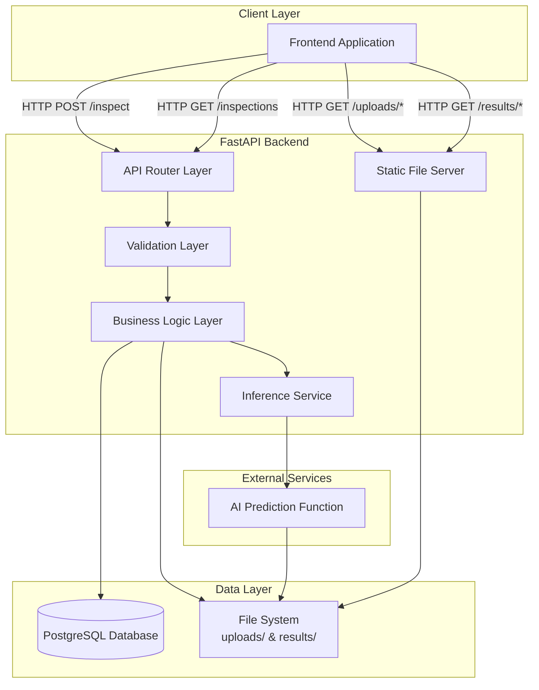
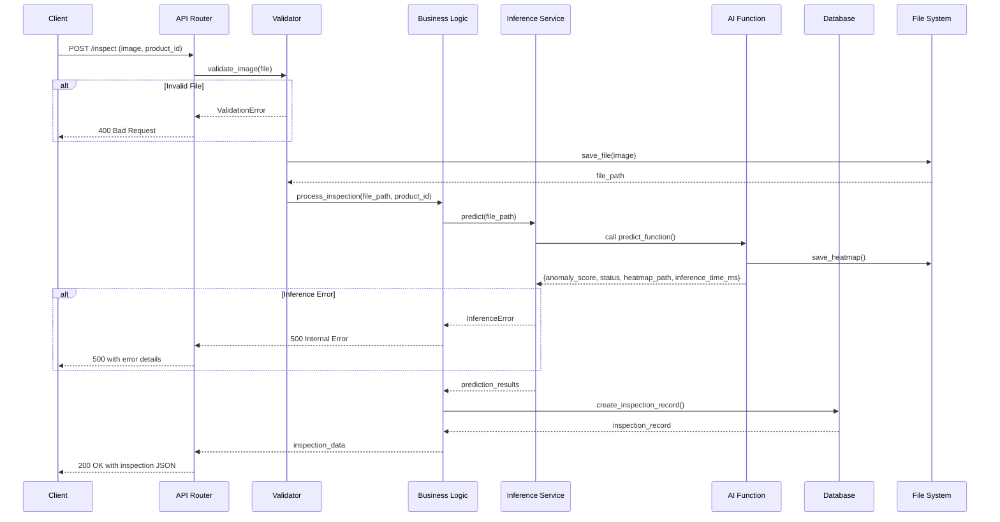

# Design Document

## Overview

INSPECTRA is a FastAPI-based backend service that provides an HTTP API for AI-powered defect detection in product images. The system architecture follows a layered approach with clear separation between HTTP handling, business logic, AI inference, and data persistence.

### Key Design Principles

1. **Separation of Concerns**: HTTP layer, business logic, AI inference, and database operations are isolated into distinct components
2. **Dependency Injection**: Database sessions and inference services are injected where needed for testability
3. **Fail-Fast Validation**: Input validation occurs at the earliest possible point in the request pipeline
4. **Stateless Operations**: Each request is independent, allowing horizontal scaling
5. **Standardized Error Handling**: Consistent error response format across all endpoints

### Technology Stack

- **Web Framework**: FastAPI (provides async support, automatic OpenAPI docs, and Pydantic validation)
- **ORM**: SQLAlchemy (database abstraction with PostgreSQL support)
- **Database**: PostgreSQL (primary), SQLite (development fallback)
- **AI Integration**: Pre-existing inference function (provided as external dependency)
- **File Storage**: Local filesystem with static file serving via FastAPI

### System Context

The backend serves as the intermediary between:
- Frontend web application (consumes REST API)
- AI inference function (provided externally, returns defect predictions)
- PostgreSQL database (stores inspection history)
- Local filesystem (stores uploaded images and generated heatmaps)

---

## Architecture

### High-Level Architecture



### Request Flow: Image Inspection



### Component Interaction

The system follows a clear dependency flow:

1. **API Layer** → Depends on business logic and validation
2. **Business Logic** → Depends on inference service and database repository
3. **Inference Service** → Depends on external AI function
4. **Database Repository** → Depends on SQLAlchemy ORM
5. **Static File Server** → Directly serves files from filesystem

No circular dependencies exist. Each layer can be tested independently through dependency injection.

---

## Components and Interfaces

### 1. API Router Layer

**Responsibility**: Handle HTTP requests, route to appropriate handlers, manage response formatting

**Endpoints**:

```python
# Inspection operations
POST   /inspect                  # Upload and inspect image
GET    /inspections              # List all inspections
GET    /inspections/{id}         # Get specific inspection

# Static file serving
GET    /uploads/{filename}       # Serve uploaded images
GET    /results/{filename}       # Serve result heatmaps

# Health check
GET    /health                   # Service health status
```

**Interface**:
```python
@router.post("/inspect", response_model=InspectionResponse, status_code=200)
async def inspect_image(
    file: UploadFile,
    product_id: str = Form(...),
    db: Session = Depends(get_db)
) -> InspectionResponse:
    """
    Upload and inspect a product image.
    
    Returns: InspectionResponse with id, product_id, image_url, 
             heatmap_url, anomaly_score, status, inference_time_ms, created_at
    
    Raises:
        HTTPException(400): Invalid file format or size
        HTTPException(500): Inference or database error
    """

@router.get("/inspections", response_model=List[InspectionResponse])
async def list_inspections(db: Session = Depends(get_db)) -> List[InspectionResponse]:
    """
    Retrieve all inspection records ordered by created_at desc.
    
    Returns: Array of InspectionResponse objects (empty array if none exist)
    """

@router.get("/inspections/{id}", response_model=InspectionResponse)
async def get_inspection(
    id: int,
    db: Session = Depends(get_db)
) -> InspectionResponse:
    """
    Retrieve a specific inspection by ID.
    
    Raises:
        HTTPException(404): Inspection not found
        HTTPException(400): Invalid ID format
    """
```

### 2. Validation Layer

**Responsibility**: Validate uploaded files before processing

**Interface**:
```python
class ImageValidator:
    ALLOWED_EXTENSIONS = {"png", "jpg", "jpeg"}
    MAX_FILE_SIZE = 10 * 1024 * 1024  # 10 MB
    
    @staticmethod
    def validate_image(file: UploadFile) -> None:
        """
        Validate uploaded image file.
        
        Checks:
        - File extension is in ALLOWED_EXTENSIONS
        - File size does not exceed MAX_FILE_SIZE
        
        Raises:
            ValueError: If validation fails with descriptive message
        """
    
    @staticmethod
    def get_file_extension(filename: str) -> str:
        """Extract file extension from filename."""
        
    @staticmethod
    def generate_unique_filename(original_filename: str) -> str:
        """Generate unique filename while preserving extension."""
```

### 3. Business Logic Layer

**Responsibility**: Orchestrate inspection workflow, coordinate between inference and database

**Interface**:
```python
class InspectionService:
    def __init__(self, db: Session, inference_service: InferenceService):
        self.db = db
        self.inference_service = inference_service
    
    def process_inspection(
        self,
        image_path: str,
        product_id: str
    ) -> InspectionRecord:
        """
        Process a complete inspection workflow.
        
        Steps:
        1. Call inference service to get prediction
        2. Validate inference results
        3. Create and persist inspection record
        4. Return inspection data
        
        Args:
            image_path: Path to uploaded image file
            product_id: Product identifier from form data
            
        Returns:
            InspectionRecord with all fields populated
            
        Raises:
            InferenceError: If prediction fails
            DatabaseError: If record creation fails
        """
```

### 4. Inference Service

**Responsibility**: Interface with external AI prediction function, validate results

**Interface**:
```python
class InferenceService:
    def __init__(self, predict_function: Callable):
        self.predict_function = predict_function
    
    def predict(self, image_path: str) -> PredictionResult:
        """
        Call AI prediction function and validate results.
        
        Args:
            image_path: Absolute or relative path to image file
            
        Returns:
            PredictionResult containing:
                - anomaly_score: float [0.0, 1.0]
                - status: Literal["PASS", "REJECT", "REVIEW"]
                - heatmap_path: str (path to generated heatmap)
                - inference_time_ms: int
                
        Raises:
            InferenceError: If prediction fails or results are invalid
        """
    
    def validate_prediction_result(self, result: dict) -> None:
        """
        Validate prediction result structure and values.
        
        Checks:
        - anomaly_score is float in [0.0, 1.0]
        - status is one of PASS, REJECT, REVIEW
        - heatmap_path points to existing file
        - All required fields are present
        
        Raises:
            ValueError: If validation fails
        """
```

### 5. Database Repository

**Responsibility**: Handle all database operations for inspection records

**Interface**:
```python
class InspectionRepository:
    def __init__(self, db: Session):
        self.db = db
    
    def create(self, inspection_data: InspectionCreate) -> Inspection:
        """
        Create a new inspection record.
        
        Args:
            inspection_data: InspectionCreate with all required fields
            
        Returns:
            Inspection model with generated id and created_at
            
        Raises:
            DatabaseError: If creation fails
        """
    
    def get_all(self) -> List[Inspection]:
        """
        Retrieve all inspections ordered by created_at desc.
        
        Returns:
            List of Inspection models (empty if none exist)
        """
    
    def get_by_id(self, inspection_id: int) -> Optional[Inspection]:
        """
        Retrieve inspection by ID.
        
        Returns:
            Inspection model or None if not found
        """
```

### 6. File Storage Service

**Responsibility**: Handle file system operations for uploads and results

**Interface**:
```python
class FileStorageService:
    UPLOADS_DIR = "uploads"
    RESULTS_DIR = "results"
    
    def __init__(self):
        self.ensure_directories()
    
    def ensure_directories(self) -> None:
        """Create uploads and results directories if they don't exist."""
    
    def save_upload(self, file: UploadFile, filename: str) -> str:
        """
        Save uploaded file to uploads directory.
        
        Returns:
            Relative path to saved file
            
        Raises:
            IOError: If save operation fails
        """
    
    def get_upload_url(self, filename: str) -> str:
        """Generate URL for uploaded file."""
    
    def get_result_url(self, filename: str) -> str:
        """Generate URL for result heatmap."""
```

---

## Data Models

### Database Schema

**Table: inspections**

```sql
CREATE TABLE inspections (
    id SERIAL PRIMARY KEY,
    product_id VARCHAR(255) NOT NULL,
    image_path VARCHAR(512) NOT NULL,
    heatmap_path VARCHAR(512),
    anomaly_score FLOAT NOT NULL,
    status VARCHAR(20) NOT NULL,
    inference_time_ms INTEGER NOT NULL,
    created_at TIMESTAMP NOT NULL DEFAULT CURRENT_TIMESTAMP
);

CREATE INDEX idx_inspections_created_at ON inspections(created_at DESC);
CREATE INDEX idx_inspections_product_id ON inspections(product_id);
CREATE INDEX idx_inspections_status ON inspections(status);
```

**Indexes**:
- `created_at DESC`: Optimize retrieval of recent inspections
- `product_id`: Support filtering by product
- `status`: Support filtering by inspection status

### SQLAlchemy ORM Model

```python
from sqlalchemy import Column, Integer, String, Float, DateTime
from sqlalchemy.sql import func
from database import Base

class Inspection(Base):
    __tablename__ = "inspections"
    
    id = Column(Integer, primary_key=True, index=True, autoincrement=True)
    product_id = Column(String(255), nullable=False, index=True)
    image_path = Column(String(512), nullable=False)
    heatmap_path = Column(String(512), nullable=True)
    anomaly_score = Column(Float, nullable=False)
    status = Column(String(20), nullable=False, index=True)
    inference_time_ms = Column(Integer, nullable=False)
    created_at = Column(DateTime(timezone=True), server_default=func.now(), nullable=False, index=True)
```

### Pydantic Models

**Request/Response Models**:

```python
from pydantic import BaseModel, Field, validator
from datetime import datetime
from typing import Literal

class InspectionCreate(BaseModel):
    product_id: str = Field(..., min_length=1, max_length=255)
    image_path: str
    heatmap_path: str
    anomaly_score: float = Field(..., ge=0.0, le=1.0)
    status: Literal["PASS", "REJECT", "REVIEW"]
    inference_time_ms: int = Field(..., gt=0)

class InspectionResponse(BaseModel):
    id: int
    product_id: str
    image_url: str  # Full URL to uploaded image
    heatmap_url: str  # Full URL to heatmap
    anomaly_score: float
    status: Literal["PASS", "REJECT", "REVIEW"]
    inference_time_ms: int
    created_at: datetime
    
    class Config:
        orm_mode = True

class PredictionResult(BaseModel):
    anomaly_score: float = Field(..., ge=0.0, le=1.0)
    status: Literal["PASS", "REJECT", "REVIEW"]
    heatmap_path: str
    inference_time_ms: int = Field(..., gt=0)
    
    @validator('heatmap_path')
    def validate_heatmap_exists(cls, v):
        if not os.path.exists(v):
            raise ValueError(f"Heatmap file not found: {v}")
        return v

class ErrorResponse(BaseModel):
    error: str
    detail: str = None
```

### Data Flow

```
1. Upload → UploadFile (FastAPI)
2. Validation → Validated file saved to filesystem
3. Inference → PredictionResult (validated)
4. Persistence → InspectionCreate → Inspection (ORM)
5. Response → InspectionResponse (with URLs)
```

---

## Correctness Properties

*A property is a characteristic or behavior that should hold true across all valid executions of a system—essentially, a formal statement about what the system should do. Properties serve as the bridge between human-readable specifications and machine-verifiable correctness guarantees.*

### Acceptance Criteria Testing Prework

1.1 WHEN the Backend_API starts, THE Backend_API SHALL establish a connection to the PostgreSQL Database
  Thoughts: This is testing infrastructure setup at application start. It's a one-time initialization check, not something that varies with input. This is a smoke test to verify the database is accessible.
  Classification: SMOKE
  Test Strategy: Single test to verify database connection succeeds at startup

1.2 WHEN the Backend_API starts, THE Backend_API SHALL create the uploads directory if it does not exist
  Thoughts: This is testing filesystem initialization. It's a one-time setup operation. Either the directory gets created or it doesn't.
  Classification: SMOKE
  Test Strategy: Single test to verify directory exists after startup

1.3 WHEN the Backend_API starts, THE Backend_API SHALL create the results directory if it does not exist
  Thoughts: Same as 1.2 - this is one-time initialization.
  Classification: SMOKE
  Test Strategy: Single test to verify directory exists after startup

1.4 WHEN the Backend_API starts, THE Backend_API SHALL mount the uploads directory as a static file path
  Thoughts: This is testing FastAPI static file mount configuration. One-time setup.
  Classification: SMOKE
  Test Strategy: Single test to verify static mount is configured

1.5 WHEN the Backend_API starts, THE Backend_API SHALL mount the results directory as a static file path
  Thoughts: Same as 1.4 - one-time configuration.
  Classification: SMOKE
  Test Strategy: Single test to verify static mount is configured

1.6 WHEN the Backend_API starts, THE Backend_API SHALL create database tables if they do not exist
  Thoughts: This is testing database schema initialization. One-time setup.
  Classification: SMOKE
  Test Strategy: Single test to verify tables exist after startup

2.1 WHEN a POST request is received at /inspect with multipart form data, THE Backend_API SHALL accept the request
  Thoughts: This is testing that the endpoint exists and accepts the right content type. This is a specific example.
  Classification: EXAMPLE
  Test Strategy: Unit test with valid multipart form data

2.2 WHEN an uploaded file is received, THE Image_Validator SHALL verify the file format is PNG, JPG, or JPEG
  Thoughts: This tests validation logic across different file types. We can generate files with various extensions and verify only allowed ones pass. This is testing OUR validation code with inputs that vary meaningfully.
  Classification: PROPERTY
  Test Strategy: Generate random filenames with various extensions, verify only PNG/JPG/JPEG are accepted

2.3 WHEN an uploaded file exceeds 10 MB, THE Image_Validator SHALL reject the file with an error message
  Thoughts: This is testing a specific boundary condition. This is an edge case that should be covered by our property test generators.
  Classification: EDGE_CASE
  Test Strategy: Property test generators should include oversized files

2.4 WHEN an uploaded file has an unsupported format, THE Image_Validator SHALL reject the file with an error message
  Thoughts: This is the inverse of 2.2 - rejecting invalid extensions. Already covered by the property test for 2.2.
  Classification: PROPERTY
  Test Strategy: Same as 2.2 - generate random extensions and verify unsupported ones are rejected

2.5 WHEN an uploaded file passes validation, THE Backend_API SHALL save the file to the uploads directory with a unique filename
  Thoughts: This tests that valid files get saved with unique names. We can generate random valid files and verify they're saved with unique filenames.
  Classification: PROPERTY
  Test Strategy: Generate random valid files, verify each gets saved with unique filename

2.6 WHEN saving an uploaded file, THE Backend_API SHALL preserve the original file extension
  Thoughts: This tests that filename generation preserves extensions. We can generate files with various valid extensions and verify they're preserved.
  Classification: PROPERTY
  Test Strategy: Generate files with various valid extensions, verify extension is preserved in saved filename

3.1 WHEN a valid image is saved to the uploads directory, THE Inference_Service SHALL call the predict function with the image path
  Thoughts: This is testing that our code calls the external AI function. This is about integration behavior with one specific path per test.
  Classification: EXAMPLE
  Test Strategy: Unit test with mock to verify predict function is called with correct path

3.2 WHEN the predict function is called, THE Inference_Service SHALL receive a dictionary containing anomaly_score, status, heatmap_path, and inference_time_ms
  Thoughts: This is testing external service behavior, not our code. The AI function's output structure is fixed.
  Classification: EXAMPLE
  Test Strategy: Unit test with mock to verify we handle the expected dictionary structure

3.3 WHEN the predict function returns results, THE Inference_Service SHALL validate that anomaly_score is a float between 0.0 and 1.0
  Thoughts: This tests OUR validation logic. We can generate various anomaly_score values (negative, >1, valid range) and verify our validator correctly accepts/rejects them.
  Classification: PROPERTY
  Test Strategy: Generate random anomaly_score values, verify only [0.0, 1.0] range is accepted

3.4 WHEN the predict function returns results, THE Inference_Service SHALL validate that status is one of PASS, REJECT, or REVIEW
  Thoughts: This tests OUR validation logic. We can generate various status strings and verify only valid ones are accepted.
  Classification: PROPERTY
  Test Strategy: Generate random status strings, verify only PASS/REJECT/REVIEW are accepted

3.5 WHEN the predict function returns results, THE Inference_Service SHALL validate that heatmap_path points to an existing file
  Thoughts: This tests OUR validation logic. We can generate paths (some existing, some not) and verify our validator correctly checks file existence.
  Classification: PROPERTY
  Test Strategy: Generate random file paths, verify only existing files pass validation

3.6 IF the predict function raises an exception, THEN THE Inference_Service SHALL log the error and return a descriptive error message
  Thoughts: This is testing specific error handling behavior. This is an example of how we handle exceptions.
  Classification: EXAMPLE
  Test Strategy: Unit test with mock that raises exception, verify error is logged and proper error response returned

4.1-4.9 Inspection Record Persistence criteria
  Thoughts: These test database record creation with various field values. We can generate random valid inspection data and verify records are created correctly with all fields populated. This tests OUR code's database interaction logic.
  Classification: PROPERTY
  Test Strategy: Generate random inspection data, verify all fields are correctly persisted and retrieved

4.10 WHEN the Inspection_Record is successfully saved, THE Backend_API SHALL return the complete inspection data as JSON
  Thoughts: This tests that saved records are correctly serialized to JSON. We can generate random records and verify the JSON output contains all expected fields.
  Classification: PROPERTY
  Test Strategy: Generate random inspection records, verify JSON serialization contains all fields

5.1 WHEN a GET request is received at /inspections, THE Backend_API SHALL retrieve all Inspection_Record entries from the Database
  Thoughts: This tests retrieval of all records. This is an example of calling the endpoint and verifying it returns data.
  Classification: EXAMPLE
  Test Strategy: Create some records, call endpoint, verify all are returned

5.2 WHEN retrieving inspection records, THE Backend_API SHALL order results by created_at in descending order
  Thoughts: This tests that ordering is correct. We can generate multiple records with different timestamps and verify they're returned in correct order.
  Classification: PROPERTY
  Test Strategy: Generate records with random timestamps, verify they're returned in descending order by created_at

5.3 WHEN inspection records are retrieved, THE Backend_API SHALL return them as a JSON array
  Thoughts: This is testing response format. This is an example.
  Classification: EXAMPLE
  Test Strategy: Unit test to verify response is a JSON array

5.4 WHEN no inspection records exist, THE Backend_API SHALL return an empty JSON array
  Thoughts: This is testing a specific edge case - empty database. This is an example.
  Classification: EXAMPLE
  Test Strategy: Unit test with empty database, verify empty array is returned

6.1 WHEN a GET request is received at /inspections/{id}, THE Backend_API SHALL retrieve the Inspection_Record with the matching id from the Database
  Thoughts: This tests retrieval by ID. We can generate random IDs and records and verify correct retrieval.
  Classification: PROPERTY
  Test Strategy: Generate random inspection records, verify each can be retrieved by its ID

6.2 WHEN the requested inspection id exists, THE Backend_API SHALL return the Inspection_Record as JSON
  Thoughts: This is redundant with 6.1 - if we can retrieve by ID, we're returning it as JSON.
  Classification: PROPERTY
  Test Strategy: Combined with 6.1

6.3 WHEN the requested inspection id does not exist, THE Backend_API SHALL return a 404 status code with an error message
  Thoughts: This tests error handling for non-existent IDs. We can generate random IDs that don't exist and verify 404 response.
  Classification: PROPERTY
  Test Strategy: Generate random non-existent IDs, verify 404 is returned

6.4 WHEN the id parameter is not a valid integer, THE Backend_API SHALL return a 400 status code with an error message
  Thoughts: This tests input validation for invalid ID format. This is typically handled by FastAPI automatically with path parameter typing.
  Classification: EXAMPLE
  Test Strategy: Unit test with invalid ID string, verify 400 is returned

7.1 WHEN a GET request is received for /uploads/{filename}, THE Static_File_Server SHALL serve the file from the uploads directory
  Thoughts: This tests static file serving. We can generate various filenames and verify they're served correctly.
  Classification: PROPERTY
  Test Strategy: Generate random valid filenames, verify files are served correctly

7.2 WHEN a GET request is received for /results/{filename}, THE Static_File_Server SHALL serve the file from the results directory
  Thoughts: Same as 7.1 for results directory.
  Classification: PROPERTY
  Test Strategy: Generate random valid filenames, verify files are served correctly

7.3 WHEN a requested file does not exist, THE Static_File_Server SHALL return a 404 status code
  Thoughts: This tests error handling for non-existent files. We can generate random non-existent filenames and verify 404.
  Classification: PROPERTY
  Test Strategy: Generate random non-existent filenames, verify 404 is returned

7.4 WHEN a file is served, THE Static_File_Server SHALL set the appropriate Content-Type header based on the file extension
  Thoughts: This tests that content-type headers are set correctly. We can generate files with various extensions and verify correct headers. This is typically handled by FastAPI's StaticFiles middleware automatically.
  Classification: PROPERTY
  Test Strategy: Generate files with various extensions (jpg, png, jpeg), verify correct Content-Type header

8.1-8.9 Database Schema Definition
  Thoughts: These are schema definition requirements, not functional tests. We verify the schema is correct through database integration tests, not property tests.
  Classification: SMOKE
  Test Strategy: Schema validation test to verify table structure matches specification

9.1 WHEN a validation error occurs, THE Backend_API SHALL return a JSON response with an error field containing the error message
  Thoughts: This tests error response format. We can generate various validation errors and verify response format.
  Classification: PROPERTY
  Test Strategy: Generate various invalid inputs, verify all error responses contain error field

9.2 WHEN a database error occurs, THE Backend_API SHALL return a 500 status code with a descriptive error message
  Thoughts: This is testing specific error handling. This is an example.
  Classification: EXAMPLE
  Test Strategy: Mock database error, verify 500 response with error message

9.3 WHEN a file operation fails, THE Backend_API SHALL return a 500 status code with a descriptive error message
  Thoughts: This is testing specific error handling. This is an example.
  Classification: EXAMPLE
  Test Strategy: Mock file operation failure, verify 500 response with error message

9.4 WHEN inference fails, THE Backend_API SHALL return a 500 status code with a descriptive error message
  Thoughts: This is testing specific error handling. This is an example.
  Classification: EXAMPLE
  Test Strategy: Mock inference failure, verify 500 response with error message

9.5 WHEN a successful inspection completes, THE Backend_API SHALL return a 200 status code with the inspection data
  Thoughts: This is testing successful response. This is an example.
  Classification: EXAMPLE
  Test Strategy: Complete valid inspection, verify 200 response with data

9.6 WHEN inspection records are successfully retrieved, THE Backend_API SHALL return a 200 status code with the data array
  Thoughts: This is testing successful response. This is an example.
  Classification: EXAMPLE
  Test Strategy: Retrieve records, verify 200 response with array

10.1 THE Backend_API SHALL read the database connection string from environment variables or configuration files
  Thoughts: This is testing configuration loading. This is a smoke test to verify config is read correctly.
  Classification: SMOKE
  Test Strategy: Verify connection string is loaded from environment/config

10.2 WHEN the database connection string is not provided, THE Backend_API SHALL use a default SQLite connection for local development
  Thoughts: This is testing fallback configuration. This is an example.
  Classification: EXAMPLE
  Test Strategy: Start app without DB config, verify SQLite is used

10.3 THE Backend_API SHALL support configuration of maximum file upload size
  Thoughts: This is testing configuration support. This is a smoke test.
  Classification: SMOKE
  Test Strategy: Verify max file size is configurable

10.4 THE Backend_API SHALL support configuration of allowed file extensions
  Thoughts: This is testing configuration support. This is a smoke test.
  Classification: SMOKE
  Test Strategy: Verify allowed extensions are configurable

10.5 THE Backend_API SHALL support configuration of upload and results directory paths
  Thoughts: This is testing configuration support. This is a smoke test.
  Classification: SMOKE
  Test Strategy: Verify directory paths are configurable

### Property 1: File Extension Validation

*For any* uploaded file with a given extension, the validator SHALL accept the file if and only if the extension is one of png, jpg, or jpeg (case-insensitive)

**Validates: Requirements 2.2, 2.4**

### Property 2: Unique Filename Generation Preserves Extension

*For any* valid uploaded file, generating a unique filename SHALL preserve the original file extension

**Validates: Requirements 2.5, 2.6**

### Property 3: Anomaly Score Validation

*For any* prediction result, the validator SHALL accept the anomaly_score if and only if it is a float value in the range [0.0, 1.0]

**Validates: Requirements 3.3**

### Property 4: Status Validation

*For any* prediction result, the validator SHALL accept the status if and only if it is one of the exact strings "PASS", "REJECT", or "REVIEW"

**Validates: Requirements 3.4**

### Property 5: Heatmap Path Validation

*For any* prediction result, the validator SHALL accept the heatmap_path if and only if the path points to a file that exists in the filesystem

**Validates: Requirements 3.5**

### Property 6: Inspection Record Persistence Round-Trip

*For any* valid inspection data (product_id, image_path, heatmap_path, anomaly_score, status, inference_time_ms), creating an inspection record and then retrieving it SHALL return data equivalent to the original input with additional generated fields (id, created_at)

**Validates: Requirements 4.1, 4.2, 4.3, 4.4, 4.5, 4.6, 4.7, 4.8, 4.9, 4.10**

### Property 7: Inspection Ordering

*For any* set of inspection records with different created_at timestamps, retrieving all inspections SHALL return them ordered by created_at in descending order (most recent first)

**Validates: Requirements 5.2**

### Property 8: Inspection Retrieval by ID

*For any* inspection record that has been persisted to the database, retrieving that inspection by its ID SHALL return the complete inspection record with all fields intact

**Validates: Requirements 6.1, 6.2**

### Property 9: Non-Existent ID Returns 404

*For any* integer ID that does not correspond to an existing inspection record, attempting to retrieve that inspection SHALL return a 404 status code with an error message

**Validates: Requirements 6.3**

### Property 10: Static File Serving

*For any* file that exists in the uploads or results directory, requesting that file via the static file endpoint SHALL successfully serve the file content

**Validates: Requirements 7.1, 7.2**

### Property 11: Non-Existent File Returns 404

*For any* filename that does not exist in the requested directory (uploads or results), attempting to access that file via the static file endpoint SHALL return a 404 status code

**Validates: Requirements 7.3**

### Property 12: Content-Type Header Correctness

*For any* image file served via static file endpoints, the response SHALL include a Content-Type header that correctly matches the file extension (image/png for .png, image/jpeg for .jpg and .jpeg)

**Validates: Requirements 7.4**

### Property 13: Error Response Format Consistency

*For any* validation error, database error, file operation error, or inference error, the error response SHALL be a JSON object containing an "error" field with a descriptive error message

**Validates: Requirements 9.1, 9.2, 9.3, 9.4**

---

## Error Handling

### Error Categories

1. **Validation Errors (400 Bad Request)**
   - Invalid file format
   - File size exceeded
   - Missing required fields
   - Invalid ID format

2. **Not Found Errors (404 Not Found)**
   - Inspection ID does not exist
   - Static file does not exist

3. **Server Errors (500 Internal Server Error)**
   - Database connection failure
   - Database operation failure
   - File system operation failure
   - AI inference failure
   - Unexpected exceptions

### Error Response Format

All errors follow a consistent JSON structure:

```json
{
    "error": "Brief error category",
    "detail": "Detailed error description"
}
```

### Error Handling Strategy

```python
# Global exception handler
@app.exception_handler(Exception)
async def global_exception_handler(request: Request, exc: Exception):
    logger.error(f"Unhandled exception: {exc}", exc_info=True)
    return JSONResponse(
        status_code=500,
        content={
            "error": "Internal server error",
            "detail": "An unexpected error occurred"
        }
    )

# Validation error handler
@app.exception_handler(RequestValidationError)
async def validation_exception_handler(request: Request, exc: RequestValidationError):
    return JSONResponse(
        status_code=400,
        content={
            "error": "Validation error",
            "detail": str(exc)
        }
    )

# Custom inference error
class InferenceError(Exception):
    pass

@app.exception_handler(InferenceError)
async def inference_exception_handler(request: Request, exc: InferenceError):
    return JSONResponse(
        status_code=500,
        content={
            "error": "Inference failed",
            "detail": str(exc)
        }
    )
```

### Logging Strategy

- **INFO**: Successful operations (inspection created, record retrieved)
- **WARNING**: Expected error conditions (file too large, invalid format)
- **ERROR**: Unexpected failures (database errors, inference crashes)
- **DEBUG**: Detailed request/response data (development only)

Log format:
```
[TIMESTAMP] [LEVEL] [MODULE] - Message (context_key=context_value)
```

---

## Testing Strategy

### Unit Tests

Unit tests focus on individual components in isolation with mocked dependencies.

**Coverage Areas:**
- Image validation logic (valid/invalid extensions, file sizes)
- Filename generation (uniqueness, extension preservation)
- Inference result validation (score ranges, status values, file existence)
- Database repository operations (with in-memory SQLite)
- Error response formatting
- Configuration loading

**Example Test Cases:**
```python
# Unit test example
def test_validate_image_invalid_extension():
    """WHEN a file has .txt extension THEN validator SHALL reject it"""
    file = create_mock_upload_file("test.txt", size=1024)
    with pytest.raises(ValueError, match="Invalid file format"):
        ImageValidator.validate_image(file)

def test_generate_unique_filename_preserves_extension():
    """WHEN generating unique filename THEN original extension SHALL be preserved"""
    filename = ImageValidator.generate_unique_filename("photo.jpg")
    assert filename.endswith(".jpg")
    assert filename != "photo.jpg"  # Should be unique
```

### Property-Based Tests

Property-based tests verify universal properties using the **Hypothesis** library for Python. Each test runs a minimum of 100 iterations with randomly generated inputs.

**Library:** Hypothesis (https://hypothesis.readthedocs.io/)

**Configuration:**
```python
from hypothesis import given, settings, strategies as st

# Global settings for all property tests
settings.register_profile("ci", max_examples=100, deadline=None)
settings.load_profile("ci")
```

**Property Test Implementation:**

Each correctness property must be implemented as a property-based test with a comment tag referencing the design document.

```python
# Feature: inspectra-fastapi-backend, Property 1: File Extension Validation
@given(extension=st.text(min_size=1, max_size=10))
@settings(max_examples=100)
def test_property_file_extension_validation(extension):
    """
    For any uploaded file extension, validator accepts IFF extension is png/jpg/jpeg
    """
    filename = f"test.{extension}"
    file = create_mock_upload_file(filename, size=1024)
    
    is_valid_extension = extension.lower() in ["png", "jpg", "jpeg"]
    
    if is_valid_extension:
        # Should not raise
        ImageValidator.validate_image(file)
    else:
        # Should raise ValueError
        with pytest.raises(ValueError):
            ImageValidator.validate_image(file)

# Feature: inspectra-fastapi-backend, Property 3: Anomaly Score Validation
@given(score=st.floats(allow_nan=False, allow_infinity=False))
@settings(max_examples=100)
def test_property_anomaly_score_validation(score):
    """
    For any prediction result, validator accepts anomaly_score IFF in [0.0, 1.0]
    """
    result = {
        "anomaly_score": score,
        "status": "PASS",
        "heatmap_path": "/tmp/test.png",
        "inference_time_ms": 100
    }
    
    is_valid_score = 0.0 <= score <= 1.0
    
    if is_valid_score:
        # Should not raise
        InferenceService.validate_prediction_result(result)
    else:
        # Should raise ValueError
        with pytest.raises(ValueError):
            InferenceService.validate_prediction_result(result)

# Feature: inspectra-fastapi-backend, Property 6: Inspection Record Persistence Round-Trip
@given(
    product_id=st.text(min_size=1, max_size=255),
    anomaly_score=st.floats(min_value=0.0, max_value=1.0),
    status=st.sampled_from(["PASS", "REJECT", "REVIEW"]),
    inference_time_ms=st.integers(min_value=1, max_value=10000)
)
@settings(max_examples=100)
def test_property_inspection_persistence_roundtrip(
    product_id, anomaly_score, status, inference_time_ms, test_db
):
    """
    For any valid inspection data, create then retrieve returns equivalent data
    """
    # Create inspection
    inspection_data = InspectionCreate(
        product_id=product_id,
        image_path="uploads/test.jpg",
        heatmap_path="results/heatmap.jpg",
        anomaly_score=anomaly_score,
        status=status,
        inference_time_ms=inference_time_ms
    )
    
    repo = InspectionRepository(test_db)
    created = repo.create(inspection_data)
    
    # Retrieve inspection
    retrieved = repo.get_by_id(created.id)
    
    # Verify round-trip
    assert retrieved is not None
    assert retrieved.product_id == product_id
    assert retrieved.anomaly_score == anomaly_score
    assert retrieved.status == status
    assert retrieved.inference_time_ms == inference_time_ms
    assert retrieved.id > 0
    assert retrieved.created_at is not None
```

**Property Test Requirements:**
- Minimum 100 iterations per test (configured via Hypothesis settings)
- Each test tagged with comment: `# Feature: inspectra-fastapi-backend, Property N: [property text]`
- Custom generators for complex types (UploadFile, database records)
- Stateful testing for database operations to verify consistency across sequences of operations

### Integration Tests

Integration tests verify component interactions with real dependencies where feasible.

**Coverage Areas:**
- End-to-end API requests (POST /inspect, GET /inspections)
- Database operations with PostgreSQL test container
- Static file serving
- Error handling across layers

**Example Test Cases:**
```python
@pytest.mark.integration
def test_inspect_endpoint_success(test_client, test_db):
    """WHEN valid image is uploaded THEN inspection record is created and returned"""
    with open("test_data/valid_image.jpg", "rb") as f:
        response = test_client.post(
            "/inspect",
            files={"file": ("test.jpg", f, "image/jpeg")},
            data={"product_id": "PROD-123"}
        )
    
    assert response.status_code == 200
    data = response.json()
    assert "id" in data
    assert data["product_id"] == "PROD-123"
    assert "anomaly_score" in data
    assert data["status"] in ["PASS", "REJECT", "REVIEW"]
```

### Test Environment Setup

**Test Database:**
- Use PostgreSQL test container (via testcontainers-python)
- Automatically start/stop container for integration tests
- Fresh database per test class

**Test Files:**
- Generate temporary test images in conftest fixtures
- Clean up after tests complete

**Mocking Strategy:**
- Mock external AI prediction function for unit and property tests
- Mock file system operations where appropriate
- Use real database for integration tests

### Test Coverage Goals

- **Unit Tests**: 80%+ line coverage
- **Property Tests**: All 13 correctness properties implemented
- **Integration Tests**: All API endpoints covered
- **Overall**: 85%+ combined coverage

---

## Implementation Approach

### Phase 1: Project Setup and Database Layer

**Goals:**
- Set up FastAPI project structure
- Configure database connection and ORM models
- Implement database repository with CRUD operations

**Tasks:**
1. Initialize FastAPI project with proper directory structure
2. Set up SQLAlchemy with PostgreSQL and SQLite support
3. Define Inspection ORM model
4. Implement database connection management and session handling
5. Implement InspectionRepository with create, get_all, get_by_id methods
6. Write unit tests for repository operations

**Deliverables:**
- Working database layer with ORM models
- Repository pattern implementation
- Unit tests for database operations

### Phase 2: File Handling and Validation

**Goals:**
- Implement file upload handling
- Create validation logic for images
- Set up static file serving

**Tasks:**
1. Implement FileStorageService for file system operations
2. Implement ImageValidator with extension and size validation
3. Implement unique filename generation
4. Configure FastAPI StaticFiles middleware for uploads and results directories
5. Write property-based tests for validation logic
6. Write unit tests for file operations

**Deliverables:**
- File upload and storage functionality
- Validation logic with comprehensive tests
- Static file serving configuration

### Phase 3: AI Inference Integration

**Goals:**
- Create inference service wrapper
- Implement result validation
- Handle inference errors gracefully

**Tasks:**
1. Define PredictionResult Pydantic model
2. Implement InferenceService with predict method
3. Implement prediction result validation
4. Add error handling for inference failures
5. Write property-based tests for result validation
6. Write unit tests with mocked AI function

**Deliverables:**
- Inference service with validation
- Error handling for AI failures
- Comprehensive test coverage

### Phase 4: Business Logic Layer

**Goals:**
- Implement inspection workflow orchestration
- Coordinate between inference, database, and file storage

**Tasks:**
1. Implement InspectionService
2. Implement process_inspection method coordinating all components
3. Add transaction handling for database operations
4. Implement error recovery and cleanup
5. Write integration tests for complete workflow

**Deliverables:**
- Business logic layer coordinating all components
- Transaction handling and error recovery
- Integration tests

### Phase 5: API Endpoints

**Goals:**
- Implement all REST API endpoints
- Add request/response validation
- Configure error handlers

**Tasks:**
1. Implement POST /inspect endpoint
2. Implement GET /inspections endpoint
3. Implement GET /inspections/{id} endpoint
4. Configure global exception handlers
5. Add request logging middleware
6. Write API integration tests
7. Generate OpenAPI documentation

**Deliverables:**
- Complete REST API
- Error handling middleware
- API integration tests
- OpenAPI documentation

### Phase 6: Configuration and Deployment Prep

**Goals:**
- Implement configuration management
- Prepare for production deployment
- Add logging and monitoring

**Tasks:**
1. Implement configuration loading from environment variables
2. Add structured logging
3. Create startup/shutdown event handlers
4. Add health check endpoint
5. Create Docker configuration
6. Write deployment documentation

**Deliverables:**
- Configuration management
- Production-ready logging
- Docker setup
- Deployment documentation

### Development Guidelines

**Code Organization:**
```
backend/
├── app/
│   ├── __init__.py
│   ├── main.py              # FastAPI app initialization
│   ├── config.py            # Configuration management
│   ├── database.py          # Database connection and session
│   ├── models/
│   │   ├── __init__.py
│   │   └── inspection.py    # SQLAlchemy ORM models
│   ├── schemas/
│   │   ├── __init__.py
│   │   └── inspection.py    # Pydantic models
│   ├── repositories/
│   │   ├── __init__.py
│   │   └── inspection.py    # Database repository
│   ├── services/
│   │   ├── __init__.py
│   │   ├── inference.py     # AI inference service
│   │   ├── inspection.py    # Business logic service
│   │   ├── validation.py    # File validation
│   │   └── storage.py       # File storage service
│   ├── routers/
│   │   ├── __init__.py
│   │   └── inspections.py   # API endpoints
│   └── middleware/
│       ├── __init__.py
│       └── error_handlers.py # Exception handlers
├── tests/
│   ├── unit/
│   ├── property/
│   └── integration/
├── uploads/                 # Created at runtime
├── results/                 # Created at runtime
├── requirements.txt
├── Dockerfile
└── README.md
```

**Dependencies:**
```txt
fastapi==0.104.0
uvicorn[standard]==0.24.0
sqlalchemy==2.0.23
psycopg2-binary==2.9.9
pydantic==2.5.0
python-multipart==0.0.6
hypothesis==6.92.0
pytest==7.4.3
pytest-asyncio==0.21.1
httpx==0.25.2
```

**Coding Standards:**
- Follow PEP 8 style guide
- Use type hints for all function signatures
- Document all public APIs with docstrings
- Keep functions focused and under 50 lines
- Use dependency injection for testability

---

## Conclusion

This design document provides a comprehensive blueprint for implementing the INSPECTRA FastAPI backend. The architecture emphasizes separation of concerns, testability, and reliability through property-based testing of critical system properties.

### Key Design Decisions

1. **Layered Architecture**: Clear separation between HTTP, business logic, and data layers enables independent testing and maintenance
2. **Repository Pattern**: Isolates database operations for easier testing and potential future database migrations
3. **Property-Based Testing**: Comprehensive validation of correctness properties ensures robust handling of edge cases
4. **Standardized Error Handling**: Consistent error responses improve frontend integration
5. **Configuration Flexibility**: Environment-based configuration supports multiple deployment environments

### Implementation Order

The six-phase implementation approach ensures:
- Early validation of core functionality (database and file handling)
- Incremental complexity addition
- Testability at each phase
- Clear milestones for progress tracking

### Next Steps

1. Review and approve this design document
2. Begin Phase 1 implementation (Project Setup and Database Layer)
3. Conduct code reviews at the end of each phase
4. Update design document if significant deviations occur during implementation
